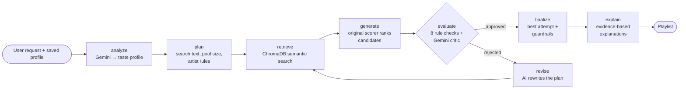

# 🎵 AI Music Discovery Agent

## Project Summary

This project started as a small content-based **music recommender simulation**: songs and a listener's taste are numbers, and a weighted formula scores how well each song fits. It has grown into an **AI music discovery agent** that keeps that formula at its core and adds three AI layers around it:

1. **Natural-language understanding:** describe what you want ("studying for finals, the vibe of Frank Ocean's *Blonde* but more upbeat and not distracting") and Gemini turns it into a structured taste profile.
2. **Retrieval (RAG):** every song in a 300-song catalog has a rich text description stored in a ChromaDB vector database, and semantic search finds the songs whose *sound* matches the request.
3. **An agent that checks its own work:** a LangGraph workflow plans the search, ranks candidates with the original formula, checks the playlist with guardrail rules, and asks a **Gemini critic** to review it. If the critic rejects it, *the AI writes the revised plan* and the agent tries again (at most two revisions).

Every song in the final playlist comes with an explanation built from evidence (catalog data, score breakdown, search match), and a Streamlit web app ties it together with accounts, a saved taste profile, and a view of every decision the agent made.

**Design rule:** the AI interprets, searches, and judges, but it never picks songs by name. Every recommendation is a real catalog entry, ranked by the transparent scoring formula.

---

## How The System Works

### The original scorer (still the core)

Real-world recommendations work by finding patterns in a user's own behavior and then accumulating a bunch of data from millions of users to then find universal patterns amongst them. This allows the system to give off recommendations that can be very similar based off of just features like genre or energy, while also allowing for a little bit of mix up here and there from the data of other users.

Since this system will be purely off content-based filtering, it will prioritize key features such as genre, energy, mood, valence and acousticness.

Song objects will have all of these attributes.

UserProfile objects have a list of favorite genres and moods, a target energy, a target acousticness (0 = electronic, 1 = fully acoustic; this used to be a yes/no "likes acoustic" flag), and a target valence which indicates how positive/happy they want songs to feel.

A score will then be calculated based off how close all the features are to the user's preference with more weight being on genre and energy.

The score works like this:

```
score = (
    0.30 * genre_sim
    + 0.15 * mood_sim
    + 0.35 * energy_sim
    + 0.10 * valence_sim
    + 0.10 * acoustic_sim
)
```

The genre and mood similarities will either be 1 or 0 depending if it is one of the user's favorites. Then an energy, valence, and acoustic similarity score will be calculated by subtracting the two scores (`1 - |song - target|`).

If songs do not exactly match the genre, the max similarity a song can be is 0.7, but this can still recommended to a user so I think the scoring is pretty fair since only two categories are all or nothing, while the rest is truly calculated based off similarity.

### The full pipeline



| Step | What happens | Who decides | Code |
|---|---|---|---|
| **analyze** | The request (plus the user's saved profile as defaults) becomes genres, moods, energy/valence/acousticness targets, song count, reference/excluded artists, and a *sound description* used for search. Values outside the catalog's vocabulary are rejected and reported. | Gemini, validated by code | [preferences.py](src/preferences.py) |
| **plan** | Sets the search text, candidate pool size (30+), the per-artist limit (2, or 1 if the user wants new artists), and exclusions. Notes reference artists missing from the catalog. | Code | [agent/planner.py](src/agent/planner.py) |
| **retrieve** | Embeds the search text and finds the closest song descriptions in ChromaDB. After some revisions it also searches inside each requested genre. | Vector search | [rag/retrieval.py](src/rag/retrieval.py) |
| **generate** | The **original weighted scorer** ranks the candidates; duplicates, excluded artists and over-represented artists are skipped. | Code | [agent/generator.py](src/agent/generator.py) |
| **evaluate** | 4 guardrail checks (real catalog songs, no duplicates, no excluded artists, artist variety) and 4 quality checks (song count, genre fit, weak picks, energy fit). If they pass, the **Gemini critic** judges the playlist against the original wording. If they fail, Gemini diagnoses why. | Rules, then Gemini | [agent/evaluator.py](src/agent/evaluator.py), [agent/critic.py](src/agent/critic.py) |
| **revise** | Applies the AI's new plan: new search text, adjusted genres/moods/targets, songs to drop, pool size, genre-filtered search. The AI's plan is validated (allowed values only, numbers clamped). Rule-based fixes are used only if Gemini is unreachable. | Gemini, validated by code | [agent/critic.py](src/agent/critic.py) |
| **finalize** | Returns the best attempt (AI-approved first), strips anything that fails a guardrail, and lists remaining limitations. | Code | [agent/workflow.py](src/agent/workflow.py) |
| **explain** | Builds facts for each song from real data and turns them into a short explanation with reasons and trade-offs. No LLM, so it can't invent claims. | Code | [agent/explainer.py](src/agent/explainer.py) |

### The music knowledge base (RAG)

Embedding just "title + artist" would make search almost useless, so each song becomes a rich document built from catalog data, plain-English descriptions of its audio features, and hand-written genre knowledge ([data/music_knowledge.json](data/music_knowledge.json)):

```
Song: Monks
Artist: Frank Ocean
Album: channel ORANGE
Genre: soul (neo soul: warm, emotional vocal music rooted in gospel and classic soul)
Mood: happy (energetic and positive)
Sound: energetic, upbeat; emotionally balanced; electronic, heavily produced; very danceable, strong groove; mid tempo (102 BPM)
Genre characteristics: expressive vocals, live instrumentation, jazzy chords, laid-back grooves, intimate and heartfelt
Related genres: r&b, funk, jazz, blues
```

- **Embeddings:** [`all-MiniLM-L6-v2`](https://huggingface.co/sentence-transformers/all-MiniLM-L6-v2) (sentence-transformers) turns each document into a 384-number vector. It runs locally on the CPU with no API key.
- **Vector store:** ChromaDB, saved in `.chroma/` with cosine similarity, one record per song (id, vector, document, metadata).
- **Built once:** the index is created on first use and reused after that. It rebuilds automatically only when the catalog, the genre knowledge, the document format, or the embedding model changes (tracked with a fingerprint).

### Data

- [data/catalog.csv](data/catalog.csv): 300 songs, 12 in each of 25 genres, sampled from two public Spotify audio-feature datasets (TidyTuesday 2020-01-21 and the Hugging Face *spotify-tracks-dataset*) by [scripts/build_catalog.py](scripts/build_catalog.py). Moods (8 labels) are **derived** from energy and valence, since neither source has mood labels.
- [data/songs.csv](data/songs.csv): the original 20-song starter dataset, still used by the original demo (`python src/main.py` with no arguments).

---

## Getting Started

### Setup

1. Create a virtual environment (optional but recommended):

   ```bash
   python -m venv .venv
   source .venv/bin/activate      # Mac or Linux
   .venv\Scripts\activate         # Windows
   ```

2. Install dependencies (includes PyTorch for sentence-transformers, so the first install is large):

   ```bash
   pip install -r requirements.txt
   ```

3. Add your Gemini key: copy `.env.example` to `.env` and fill in `GEMINI_API_KEY` ([get one here](https://aistudio.google.com/apikey)). Optional settings: `GEMINI_MODEL` (default `gemini-3.8-flash`) and `GEMINI_THINKING` (`low`/`medium`/`high`).

### Run the web app

```bash
streamlit run app.py
```

1. **Create an account.** Accounts are stored locally in `app_data/users.json`, with salted PBKDF2 password hashes only.
2. **Set up your taste profile:** favorite genres and moods, energy/positivity/acoustic sliders, artists you love, and artists to never play.
3. **Discover:**
   - Type a request (or tap an example), pick 5-20 songs, and click **Generate playlist**. You'll see each agent step live, then song cards with explanations, evidence, and Spotify links.
   - **Quick mix from my profile** builds a playlist straight from your profile, skipping request interpretation. With the **AI critic** switched off in the sidebar, it works without Gemini at all.
4. **How the AI decided:** what Gemini understood, every attempt's rule checks, the AI critic's verdict and issues, and the changes it made.

The first playlist after starting the server takes a few extra seconds while the embedding model loads. With the AI critic on, a request makes 2-4 Gemini calls.

### Run from the command line

```bash
python src/main.py "late-night drive, I like The Weeknd but want new artists"
python src/main.py --mode agent-rules "..."   # agent with rule checks only (no Gemini critic)
python src/main.py --mode rag "..."           # retrieve once, then rank (no agent loop)
python src/main.py --mode baseline "..."      # original system: score the whole catalog
python src/main.py                            # original demo with hard-coded profiles
```

The four modes are the systems to compare: original → RAG → agent (rules) → agent (AI critic).

### Running Tests

```bash
pytest
```

The suite has 120 tests and runs offline in about 10 seconds. Gemini is replaced by fakes, and the search uses a small fake embedder.

| File | What it covers |
|---|---|
| [test_recommender.py](tests/test_recommender.py), [test_catalog.py](tests/test_catalog.py) | Original scorer and catalog integrity |
| [test_preferences.py](tests/test_preferences.py) | Request interpretation guardrails: vocabulary, clamping, profile context |
| [test_retrieval.py](tests/test_retrieval.py) | Song documents, indexing, rebuild detection, filters, stale-index guardrail |
| [test_agent.py](tests/test_agent.py) | Agent reliability: exact song count, no duplicates, exclusions, artist variety, unknown artists explained, revision loop, retry limit |
| [test_critic.py](tests/test_critic.py) | The AI critic drives revisions, can't approve a failed playlist, invalid AI output is cleaned up, Gemini outages fall back to rules |
| [test_explainer.py](tests/test_explainer.py) | Explanations only use real evidence; trade-offs are mentioned |
| [test_accounts.py](tests/test_accounts.py), [test_app.py](tests/test_app.py) | Hashed passwords, profiles, and a click-through of the Streamlit app (sign up, set up a profile, log in, quick mix) |

---

## Project Structure

```
app.py                     Streamlit web app (login → profile → Discover / How the AI decided / My profile)
src/
  recommender.py           Song, UserProfile, the original weighted scorer
  preferences.py           Gemini request interpretation + shared Gemini helper
  accounts.py              Local accounts (hashed passwords) and taste profiles
  main.py                  Command-line interface
  rag/
    ingestion.py           Song → rich document; builds/refreshes the ChromaDB index
    embeddings.py          sentence-transformers embedder
    retrieval.py           Semantic search (with genre and artist filters)
    pipeline.py            Retrieve-then-rank (the "RAG" comparison mode)
  agent/
    workflow.py            LangGraph state machine (analyze → … → explain)
    planner.py             Initial strategy
    generator.py           Ranking + playlist rules + confidence
    evaluator.py           Rule checks (and the fallback reviser)
    critic.py              Gemini critic / reviser and validation of its output
    explainer.py           Evidence-based explanations and playlist summary
    state.py               Data passed between steps
  guardrails/validation.py Catalog validity and duplicate detection
data/
  catalog.csv              300-song catalog
  music_knowledge.json     Genre descriptions used to enrich song documents
scripts/build_catalog.py   Rebuilds catalog.csv from the two source datasets
```

---

## Sample Recommendation Output

### Original recommender (`python src/main.py`)

```
=== Chill lofi listener ===

Midnight Coding - Score: 0.95
-----------------------------
Because: Matches favorite genre 'lofi'
Matches favorite mood 'chill'
Energy similarity 0.97 (song 0.42, target 0.45)
Valence similarity 0.94 (song 0.56, target 0.5)
Acousticness similarity 0.71 (song 0.71, target 1.0)

Library Rain - Score: 0.94
--------------------------
Because: Matches favorite genre 'lofi'
Matches favorite mood 'chill'
Energy similarity 0.90 (song 0.35, target 0.45)
Valence similarity 0.90 (song 0.6, target 0.5)
Acousticness similarity 0.86 (song 0.86, target 1.0)
```

### The agent, with the Gemini critic (live run)

Request: *"I'm studying for finals. Recommend 10 songs that have the same vibe as Frank Ocean's Blonde, but are more upbeat and not too distracting."*

The rule checks passed the first playlist, but the AI critic rejected it and rewrote the plan:

```
[ai_review]
   REJECTED: While much of the playlist fits the warm, unobtrusive vibe, tracks like Jon Bellion's pop hit and
   Presence's angst-heavy track are too jarring or distracting for studying with a Blonde-inspired aesthetic.
   issue: [14] Jon Bellion's 'All Time Low' is too punchy, poppy, and vocal-heavy/distracting for study focus...
   issue: [257] 'Dear Depression,' has very low valence (0.17), high BPM (182), and emotionally heavy...
[revise]
   revision 1 (AI): search text -> "Smooth contemporary R&B, neo-soul, and warm lo-fi indie grooves ..."
   revision 1 (AI): moods ['relaxed', 'chill'] -> ['relaxed', 'chill', 'happy']
   revision 1 (AI): removed [14] All Time Low, [257] Dear Depression,
   revision 1 (AI): candidate pool 30 -> 45
[ai_review]
   APPROVED: The playlist captures the mellow Frank Ocean aesthetic while raising the tempo and energy just
   enough to stay upbeat without becoming distracting for studying. Including Frank Ocean's own 'Monks' ...
[finalize]
   returning attempt 2 of 2 (AI-approved; 8/8 rule checks passed)
```

A song from the final playlist, with its evidence-based explanation (from a different run, the late-night-drive request):

```
4. Shadow - Chromatics  [synthpop, relaxed]  score 0.78 (medium confidence, match 0.65)
   It's synthpop, one of your genres, its energy of 0.54 is close to your target of 0.65, and its
   acousticness of 0.01 is very close to your target of 0.10 (electronic, heavily produced). It
   closely matches the sound we searched for (similarity 0.65). Trade-off: its mood is relaxed
   rather than intense or melancholic; its positivity (valence) of 0.55 is well off your target
   of 0.35 (emotionally balanced).
   [evidence: genre, energy, acousticness, search_match, mood, valence]
```

**Screenshot or video** *(optional)*: <!-- Insert a screenshot or demo video link here -->

---

## Experiments You Tried

Observations from runs made while building the system (single runs, not averaged measurements):

- **RAG vs. the original scorer (Blonde/studying request):** retrieval found sensible candidates (chill, r&b, soul; Frank Ocean's "Monks" was the 3rd closest match). But limiting the scorer to a 30-song pool also cut out higher-scoring soul tracks the original system found by scoring all 300 songs. Retrieval adds understanding of the *sound*, at the cost of a smaller pool. This is the main motivation for the agent's revision loop.
- **Search drift:** for the late-night-drive request, words like "dark" and "intense" pulled in metal and techno, with few r&b songs. The agent caught it (5 weak picks) and a genre-filtered search fixed it on the second attempt (8/8 checks passed).
- **Rules vs. AI critic:** the rule checks passed the first Blonde/studying playlist, but the Gemini critic rejected two songs as too distracting for studying, something no rule measures. The AI-revised second attempt brought in Frank Ocean's own "Monks" and was approved.
- **Embedding weaknesses:** the model reacts to surface wording. "Dream A Little Dream Of Me" ranks highly for "dreamy r&b" partly because of the word "Dream", and a song's title can outweigh its sound. This is why retrieval only proposes candidates and the scorer ranks them.

A full comparison of the four modes (`baseline`, `rag`, `agent-rules`, `agent`) on a fixed set of requests has not been run yet.

---

## Limitations and Risks

- **Small catalog:** 300 songs, 12 per genre. Many artists users mention (e.g. Frank Ocean's *Blonde*) aren't in it, so the system searches for their *described sound* instead and says so.
- **Labels are imperfect:** genres come from the source datasets' playlist labels (The Smiths are labeled "punk", a gospel song is labeled "r&b"), and moods are a heuristic from energy and valence, not ground truth.
- **Depends on Gemini:** typed requests need Gemini to interpret them. During development the API often returned 503 "high demand" and 504 timeout errors, and calls took about 50-85 s. The critic falls back to rules when Gemini is down, and Quick mix works without it, but a typed request fails if interpretation fails.
- **The critic's reasons can be wrong:** the AI critic uses its own knowledge of songs (e.g. that a track has spoken-word elements). It can't add songs, but its *reasons* for removing one aren't verified.
- **Explanations describe the scoring, not the music:** they're built from catalog numbers and labels, so they're accurate to the data but can't speak to lyrics or production details.
- **Demo-grade accounts:** a local JSON file, no rate limiting or password reset. Not for real users.

More detail in the [model card](model_card.md).

---

## Reflection

Read and complete `model_card.md`:

[**Model Card**](model_card.md)

Write 1 to 2 paragraphs here about what you learned:

- about how recommenders turn data into predictions
- about where bias or unfairness could show up in systems like this
